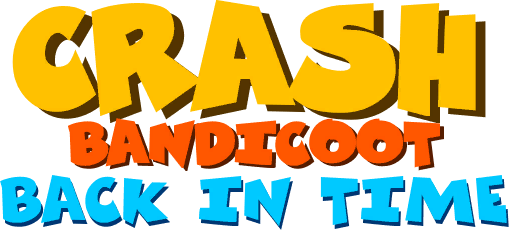

## Crash Bandicoot: Back In Time NX

<p align="center">
  
</p>
<h1 align="center">Crash Bandicoot: Back In Time - Switch Port</h1>
<br>

Wrapper/Port of Crash Bandicoot: Back In Time for Switch

An unofficial homebrew wrapper that lets the Android ARM64 build of the fan game
**Crash Bandicoot: Back in Time** (v0.95, Unity 2021.3.8f1) run on a Nintendo Switch
running custom firmware. It contains **no game code and no game assets**: you provide
the game files from your own copy, and the wrapper loads them.

Status: Work In Progress

## How to install

1. You need a ##v0.95 of Android release; extract the files from your own legally-owned copy of the game.
2. Create `sdmc:/switch/crash_bit_nx/` on your SD card and put these in it:

```
crash_bit_nx/
├── crash_bit_nx.nro
├── libmain.so
├── libunity.so
├── libil2cpp.so        <- the three .so are in the APK: lib/arm64-v8a/
└── assets/
    ├── bin/Data/                <- APK: assets/bin/Data/
    └── Crash-Creator-Content/   <- APK: assets/Crash-Creator-Content/
```

3. Open a game by holding down the 'R' button and open the NRO from the Homebrew Menu.

The first boot packs `assets/` into `assets.nxpack` and `assets.nxidx` (it takes several
minutes and shows a status screen). Do not delete those two files afterwards. The loader also
creates `levels/` (levels you make or download), `stuff/`, `debug.log`, `prefs.kv` and the
save files.

Optional files: `config.txt` (settings), `padmap.txt` (button mapping).

## Notes

- To add levels, stick them in /crash_bit_nx/levels/
- This will not run in applet/album mode.
- It’s possible that GPU overclocking might be required for levels with too many objects.

## Legal (see LICENSE)

- This software contains **no game code and no game assets** and distributes none. You must
  provide the game files yourself, from a copy you legally obtained. Do not ask for them and do
  not share them together with this software.
- Crash Bandicoot is a trademark of Activision Publishing, Inc. "Crash Bandicoot: Back in Time"
  and its code, art, music and content belong to their respective authors and rights holders.
  All trademarks and copyrights belong to their owners.
- This is an independent, non-commercial, unofficial fan project. It has **no affiliation,
  authorization, sponsorship or endorsement** from Activision, the creators of Crash Bandicoot,
  or the developers of Crash Bandicoot: Back in Time.
- It is based on **baldi_nx** and on the MIT-licensed open-source Switch `.so`-loader lineage
  (see `LICENSE`). The license covers only the wrapper and grants no rights over any game.
- Provided "as is", without warranty of any kind. Use at your own risk. Not for piracy.
- If a rights holder wants this project changed or removed, contact the author and it will be
  handled promptly.

## Credits

  - Baldi_nx by ChanseyIsTheBest, based on this project.
  - TheOfficialFloW for the original Android so-loader.

## Support

Report bugs or crashes in: https://discord.gg/vyHh4SaJyh
